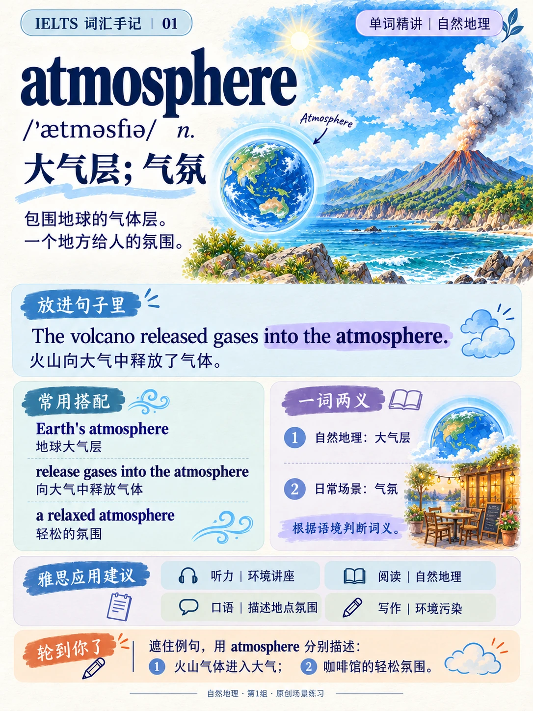
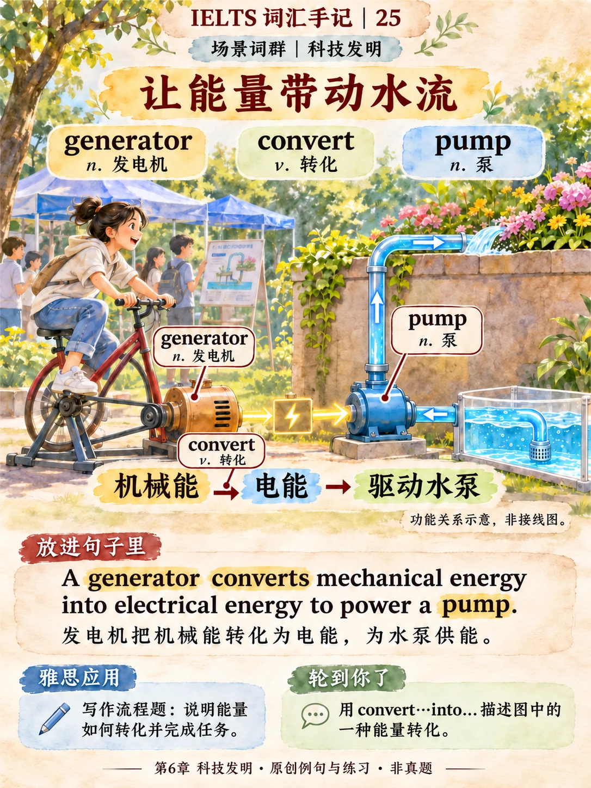

# IELTS 插画词汇手记

用画面理解词义，用例句走进语境，再用练习把词汇说出来。

**585 张插画学习卡 · 13 个完整章节 · 持续更新**

[按章节开始学习](#章节目录) · [下载 PDF 和高清原图](https://github.com/almostcorn/ielts-illustrated-vocabulary-cards/releases) · [查看制作原则](DESIGN.md)

## 这些卡片怎么用

先看主插画，理解对象、动作或关系，再读标签和双语例句。完成卡片底部练习后，查看独立答案，换成自己的场景再表达一次。手机可以先看整张图，再放大阅读小注。

插画和配色随词义与场景变化；单词精讲、场景词群和辨析采用不同构图。卡片中的雅思应用是具体学习任务，例句与练习为原创材料，非雅思真题。

## 章节目录

| 章节 | 内容 | 图片 | 章内词头 | 在线学习 | PDF | 高清完整包 |
|---|---|---:|---:|---|---|---|
| 01 | 自然地理 | 54 | 241 | [打开章节](chapters/ch01/README.md) | [下载](https://github.com/almostcorn/ielts-illustrated-vocabulary-cards/releases/download/v2026.11.09/ch01-learning-cards.pdf) | [下载](https://github.com/almostcorn/ielts-illustrated-vocabulary-cards/releases/download/v2026.11.09/ch01-study-pack.zip) |
| 02 | 植物研究 | 42 | 130 | [打开章节](chapters/ch02/README.md) | [下载](https://github.com/Eva-Lau/ielts-illustrated-vocabulary-cards/releases/download/v2026.11.05/ch02-learning-cards.pdf) | [下载](https://github.com/Eva-Lau/ielts-illustrated-vocabulary-cards/releases/download/v2026.11.05/ch02-study-pack.zip) |
| 03 | 动物保护 | 61 | 168 | [打开章节](chapters/ch03/README.md) | [下载](https://github.com/Eva-Lau/ielts-illustrated-vocabulary-cards/releases/download/v2026.11.05/ch03-learning-cards.pdf) | [下载](https://github.com/Eva-Lau/ielts-illustrated-vocabulary-cards/releases/download/v2026.11.05/ch03-study-pack.zip) |
| 04 | 太空探索 | 33 | 75 | [打开章节](chapters/ch04/README.md) | [下载](https://github.com/Eva-Lau/ielts-illustrated-vocabulary-cards/releases/download/v2026.11.05/ch04-learning-cards.pdf) | [下载](https://github.com/Eva-Lau/ielts-illustrated-vocabulary-cards/releases/download/v2026.11.05/ch04-study-pack.zip) |
| 05 | 学校教育 | 85 | 402 | [打开章节](chapters/ch05/README.md) | [下载](https://github.com/Eva-Lau/ielts-illustrated-vocabulary-cards/releases/download/v2026.11.05/ch05-learning-cards.pdf) | [下载](https://github.com/Eva-Lau/ielts-illustrated-vocabulary-cards/releases/download/v2026.11.05/ch05-study-pack.zip) |
| 06 | 科技发明 | 36 | 122 | [打开章节](chapters/ch06/README.md) | [下载](https://github.com/Eva-Lau/ielts-illustrated-vocabulary-cards/releases/download/v2026.11.05/ch06-learning-cards.pdf) | [下载](https://github.com/Eva-Lau/ielts-illustrated-vocabulary-cards/releases/download/v2026.11.05/ch06-study-pack.zip) |
| 07 | 文化历史 | 31 | 79 | [打开章节](chapters/ch07/README.md) | [下载](https://github.com/Eva-Lau/ielts-illustrated-vocabulary-cards/releases/download/v2026.11.05/ch07-learning-cards.pdf) | [下载](https://github.com/Eva-Lau/ielts-illustrated-vocabulary-cards/releases/download/v2026.11.05/ch07-study-pack.zip) |
| 08 | 语言演化 | 23 | 68 | [打开章节](chapters/ch08/README.md) | [下载](https://github.com/almostcorn/ielts-illustrated-vocabulary-cards/releases/download/v2026.11.09-ch08/ch08-learning-cards.pdf) | [下载](https://github.com/almostcorn/ielts-illustrated-vocabulary-cards/releases/download/v2026.11.09-ch08/ch08-study-pack.zip) |
| 09 | 娱乐运动 | 50 | 176 | [打开章节](chapters/ch09/README.md) | [下载](https://github.com/almostcorn/ielts-illustrated-vocabulary-cards/releases/download/v2026.11.09-ch09/ch09-learning-cards.pdf) | [下载](https://github.com/almostcorn/ielts-illustrated-vocabulary-cards/releases/download/v2026.11.09-ch09/ch09-study-pack.zip) |
| 10 | 物品材料 | 43 | 152 | [打开章节](chapters/ch10/README.md) | [下载](https://github.com/almostcorn/ielts-illustrated-vocabulary-cards/releases/download/v2026.11.11-ch10/ch10-learning-cards.pdf) | [下载](https://github.com/almostcorn/ielts-illustrated-vocabulary-cards/releases/download/v2026.11.11-ch10/ch10-study-pack.zip) |
| 11 | 时尚潮流 | 33 | 113 | [打开章节](chapters/ch11/README.md) | [下载](https://github.com/almostcorn/ielts-illustrated-vocabulary-cards/releases/download/v2026.11.12-ch11/ch11-learning-cards.pdf) | [下载](https://github.com/almostcorn/ielts-illustrated-vocabulary-cards/releases/download/v2026.11.12-ch11/ch11-study-pack.zip) |
| 12 | 饮食健康 | 53 | 173 | [打开章节](chapters/ch12/README.md) | [下载](https://github.com/almostcorn/ielts-illustrated-vocabulary-cards/releases/download/v2026.11.12-ch12/ch12-learning-cards.pdf) | [下载](https://github.com/almostcorn/ielts-illustrated-vocabulary-cards/releases/download/v2026.11.12-ch12/ch12-study-pack.zip) |
| 13 | 建筑场所 | 41 | 134 | [打开章节](chapters/ch13/README.md) | [下载](https://github.com/almostcorn/ielts-illustrated-vocabulary-cards/releases/download/v2026.11.12-ch13/ch13-learning-cards.pdf) | [下载](https://github.com/almostcorn/ielts-illustrated-vocabulary-cards/releases/download/v2026.11.12-ch13/ch13-study-pack.zip) |

全书共 22 章。第 1–13 章已完成，第 14–22 章共 9 章待制作。章内词头合计 2,033 项，跨章出现的同一个词分别计入各章。

## 文件说明

- `chapters/`：585张在线预览，以及学习文稿、练习、独立答案、词头覆盖表和可编辑内容。
- `catalog.json`：章节与卡片索引，便于检索或继续制作。
- [Releases](https://github.com/Eva-Lau/ielts-illustrated-vocabulary-cards/releases)：每章合订PDF与含高清PNG的完整学习包；预览图做了网页压缩，高清原图保持发布版本。

## 来源与说明

学习范围参考刘洪波《雅思词汇真经》的章节与词头；词义选讲、场景、例句和练习由本项目编写或经AI辅助创作，插画由AI生成。原书版权归原权利人所有，本仓库不包含原书扫描件。本项目与教材出版方、IELTS考试机构没有隶属关系。

图中历史制度、实验、数量和人物关系可能采用教学示意，具体边界见卡面及配套用法说明。发现文字或图义问题，欢迎提交Issue并注明章节和卡号。

公开仓库用于分享与学习，目前未另行授予统一的开源内容许可；转载、再发布或商业使用请先联系维护者。

维护者：[Evelyn](https://github.com/Eva-Lau) · 更新于2026-11-12
