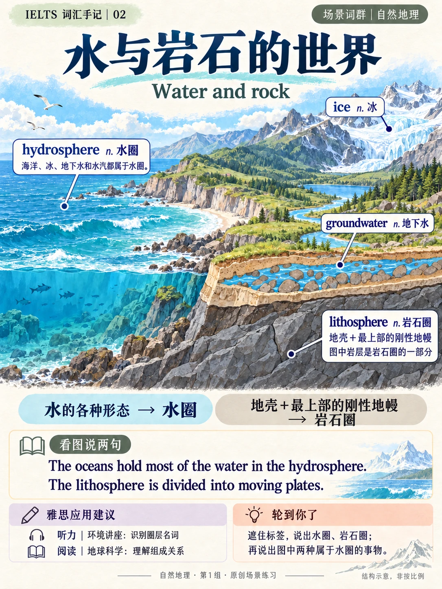
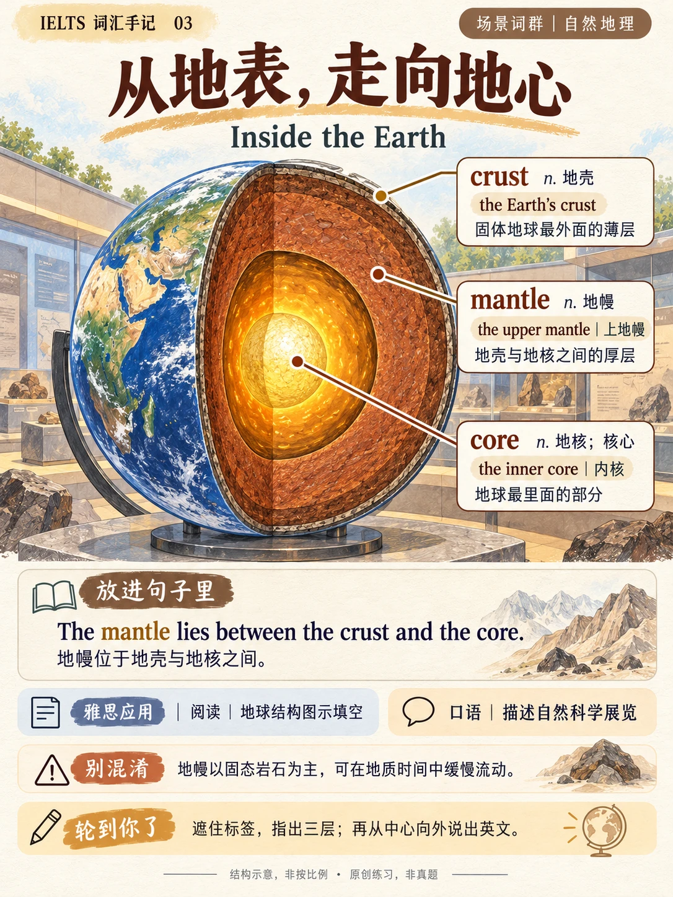
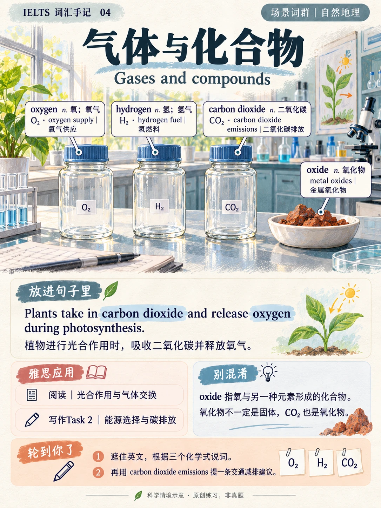
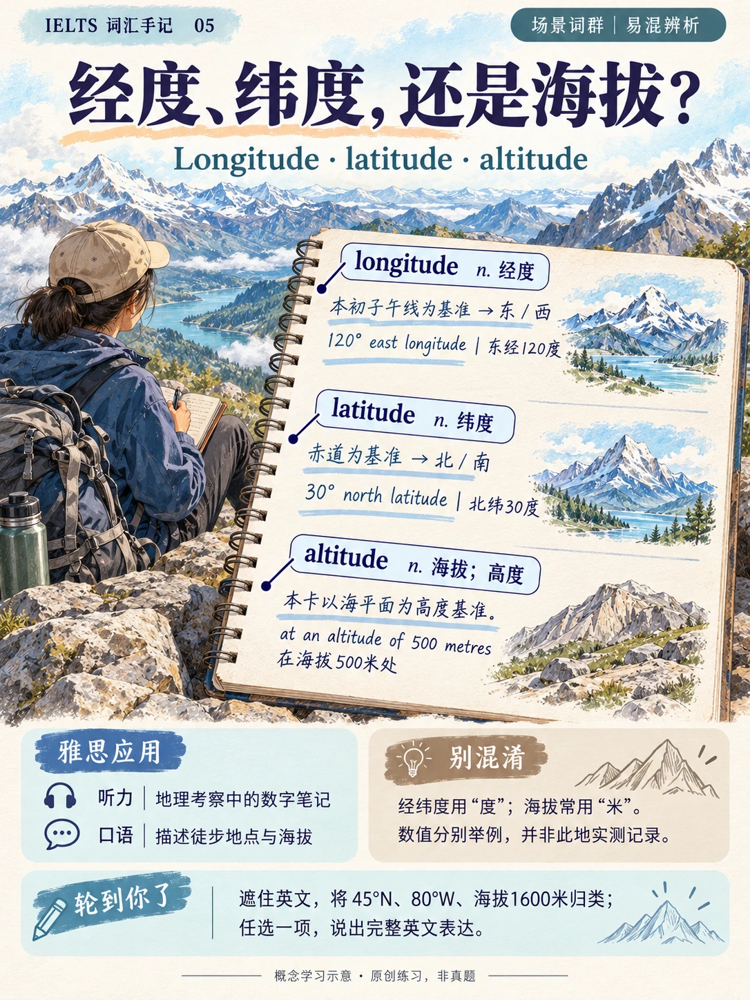
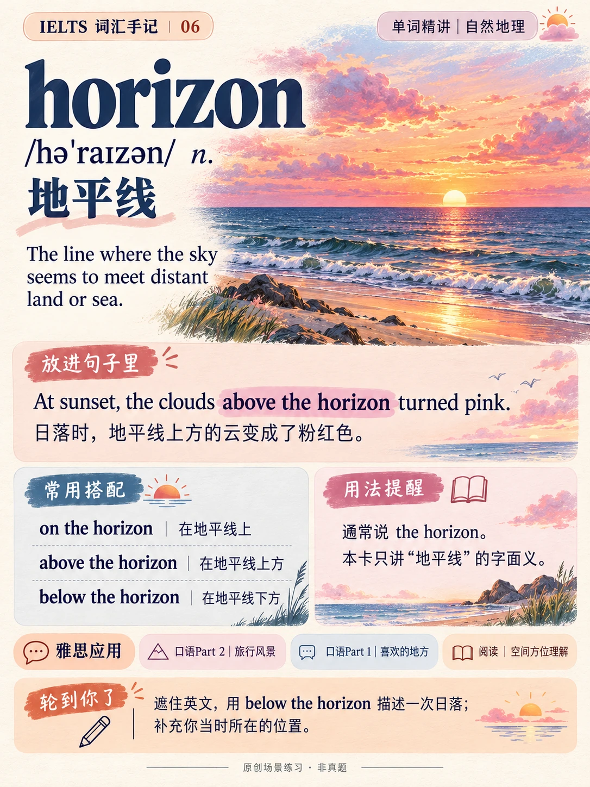
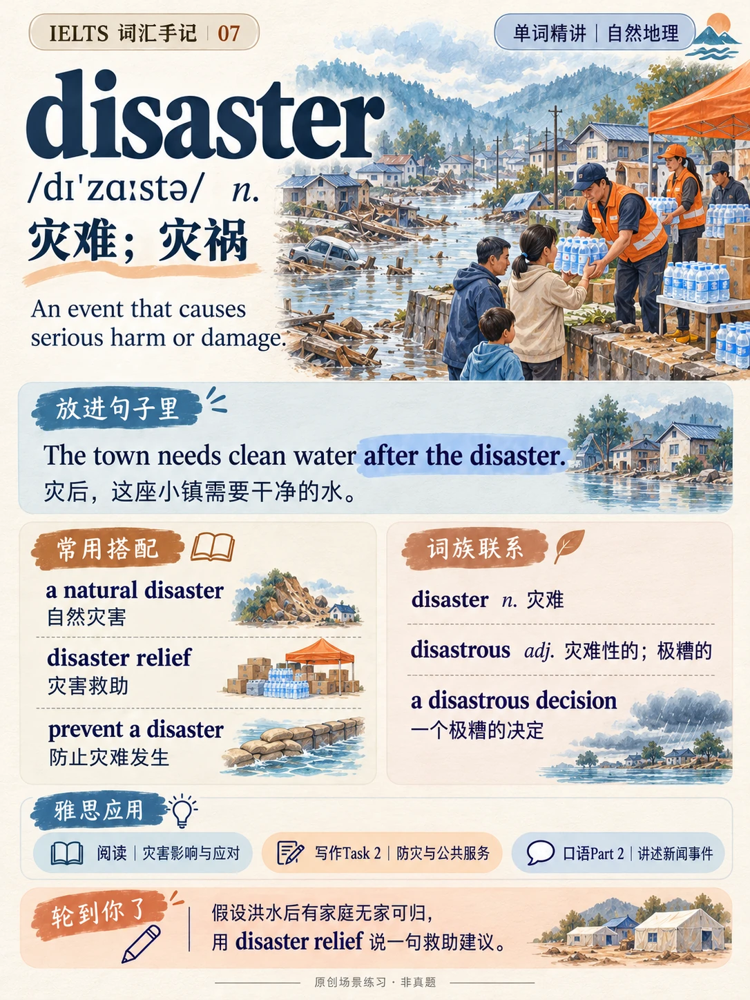
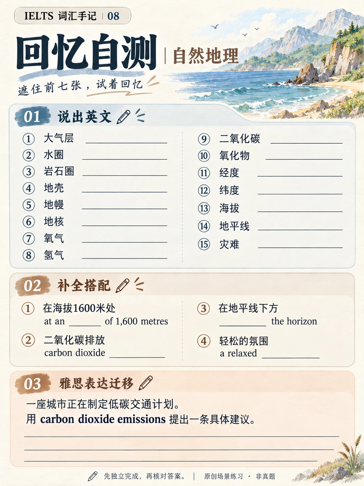

# 第1章 · 自然地理·第1组

本章仅完成第一组，整章尚未完成。共8张图片，覆盖15个章内词头。

[下载高清完整包](https://github.com/Eva-Lau/ielts-illustrated-vocabulary-cards/releases/download/v2026.11.05/ch01-study-pack.zip) · [下载合订 PDF](https://github.com/Eva-Lau/ielts-illustrated-vocabulary-cards/releases/download/v2026.11.05/ch01-learning-cards.pdf) · [全部版本下载](https://github.com/Eva-Lau/ielts-illustrated-vocabulary-cards/releases)

[学习文稿](study-notes.md) · [独立练习](exercises.md) · [参考答案](answers.md) · [词头覆盖表](coverage.csv) · [制作提示词](prompts.md) · [结构化内容](cards.json)

下面是供在线浏览的 WebP 预览；高清 PNG 原图保存在完整包中。

| 卡号 | 主题 | 词汇 / 任务 | 图片 |
|---|---|---|---|
| 01 | atmosphere | atmosphere | [打开图片](previews/01.webp) |
| 02 | hydrosphere / lithosphere | hydrosphere、lithosphere | [打开图片](previews/02.webp) |
| 03 | crust / mantle / core | crust、mantle、core | [打开图片](previews/03.webp) |
| 04 | oxygen / hydrogen / carbon dioxide / oxide | oxygen、hydrogen、carbon dioxide、oxide | [打开图片](previews/04.webp) |
| 05 | longitude / latitude / altitude | longitude、latitude、altitude | [打开图片](previews/05.webp) |
| 06 | horizon | horizon | [打开图片](previews/06.webp) |
| 07 | disaster | disaster | [打开图片](previews/07.webp) |
| 08 | 复习与应用 8 |  | [打开图片](previews/08.webp) |

## 图片预览

### 01 · atmosphere

### 02 · hydrosphere / lithosphere

### 03 · crust / mantle / core

### 04 · oxygen / hydrogen / carbon dioxide / oxide

### 05 · longitude / latitude / altitude

### 06 · horizon

### 07 · disaster

### 08 · 复习与应用 8

